<p align="center">
  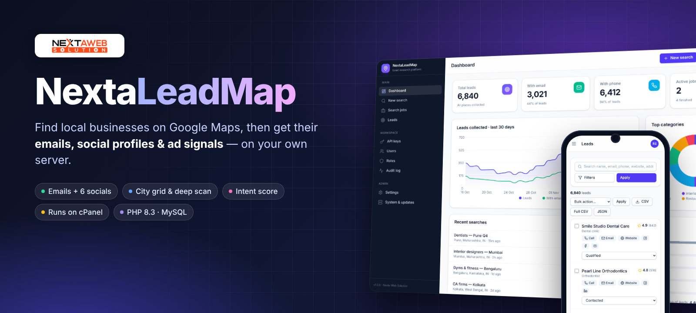
</p>

<p align="center">
  
  
  
  
  
  
  <a href="SECURITY-AUDIT.md"></a>
  
</p>

<p align="center">
  <a href="#-watch-the-60-second-intro"><b>Intro video</b></a> ·
  <a href="#-see-it-in-action"><b>Screenshots</b></a> ·
  <a href="#-what-you-get"><b>Features</b></a> ·
  <a href="#-install-in-10-minutes-cpanel"><b>Install</b></a> ·
  <a href="#-rest-api"><b>API</b></a> ·
  <a href="#-how-it-compares"><b>Compare</b></a> ·
  <a href="#-faq"><b>FAQ</b></a>
</p>

**Stop copying leads from Google Maps by hand.** Type a business type and a city — *"dentists in Pune"* —
and NextaLeadMap returns an outreach-ready list: name, phone, **email**, website, category, address,
rating and review count, plus **Instagram, Facebook, LinkedIn, TikTok, YouTube and X**, and an
**intent score** that tells you who already spends on ads.

It is a complete web app you host yourself — on cPanel shared hosting or a VPS — with a team dashboard,
lead pipeline, REST API and one-click signed updates. Built in plain PHP 8.3 and MySQL. No Node.js, no Python, no Docker.

<table>
  <tr>
    <td align="center" width="25%">🗺️<br><b>Whole-city coverage</b><br><sub>N×N grid + deep scan past<br>the per-search cap</sub></td>
    <td align="center" width="25%">📧<br><b>Emails + 6 socials</b><br><sub>homepage + contact page crawl,<br>junk & no-reply filtered</sub></td>
    <td align="center" width="25%">🎯<br><b>Intent score 0–100</b><br><sub>Meta pixel, Google Ads,<br>analytics, CMS, mobile</sub></td>
    <td align="center" width="25%">🔒<br><b>Your server, your data</b><br><sub>encrypted keys, RBAC,<br>audit log, signed updates</sub></td>
  </tr>
</table>

| I want to… | Start here |
|---|---|
| 🎬 See it in one minute | [Intro video](#-watch-the-60-second-intro) |
| 🚀 Install it on my hosting today | [Install in 10 minutes](#-install-in-10-minutes-cpanel) |
| 📋 Know exactly what I get per lead | [What you get](#-what-you-get) · [Sample output](#sample-output) |
| 🤖 Connect it to my CRM or automations | [REST API](#-rest-api) |
| 🛡️ Check it is safe to deploy | [Security](#-security) · [Audit report](SECURITY-AUDIT.md) |

---

## 🎬 Watch the 60-second intro

<p align="center">
  <a href="docs/assets/nextaleadmap-intro.mp4">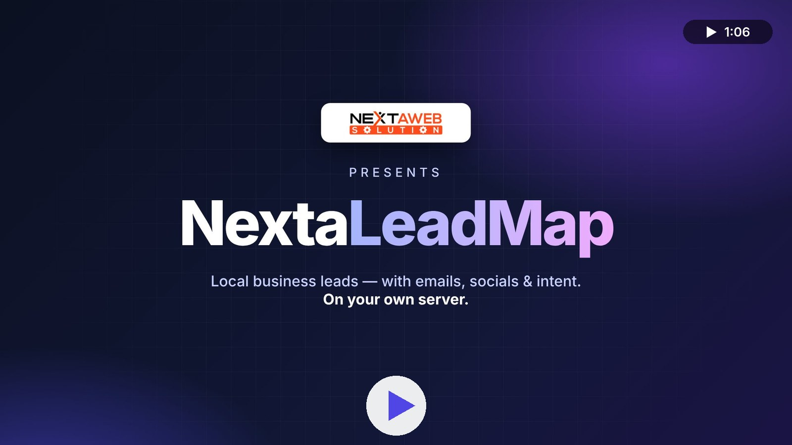</a>
  <br><sub>Click to play · 1080p · <a href="docs/assets/nextaleadmap-intro.mp4">download MP4</a></sub>
</p>

---

## 📸 See it in action

<sub>Real screens of the app. Business names, phones and emails shown are sample data.</sub>

### 1 · Start a search in seconds
Pick from 201 business-type presets or type your own, choose a city from 168,000 places, and decide how
deep to go. The summary shows searches, API calls and the most places you can get **before** you spend anything.

<p align="center">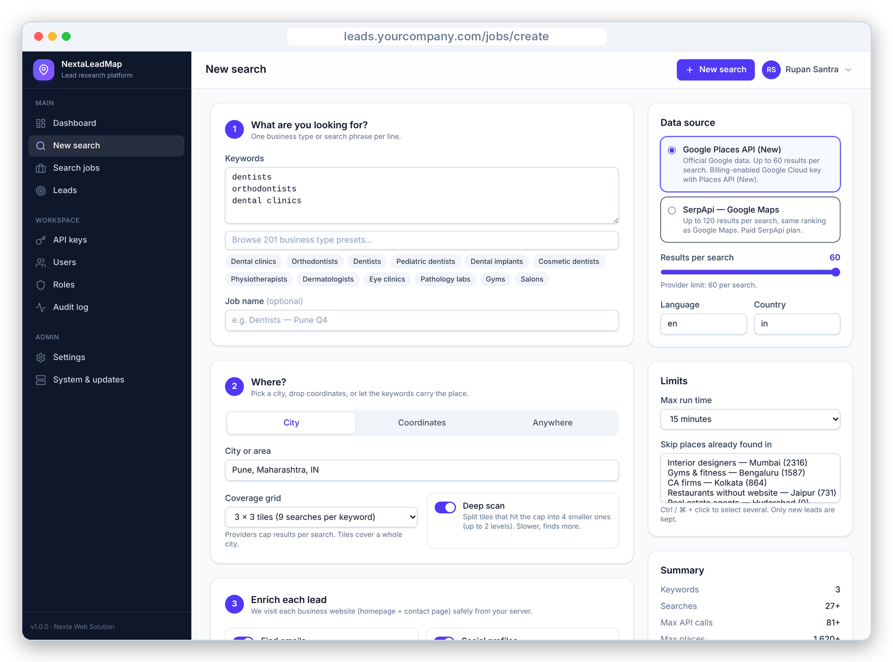</p>

### 2 · Watch it work
Jobs run in the background — close the tab, come back later. Live progress, places and emails found, API calls used.

<p align="center">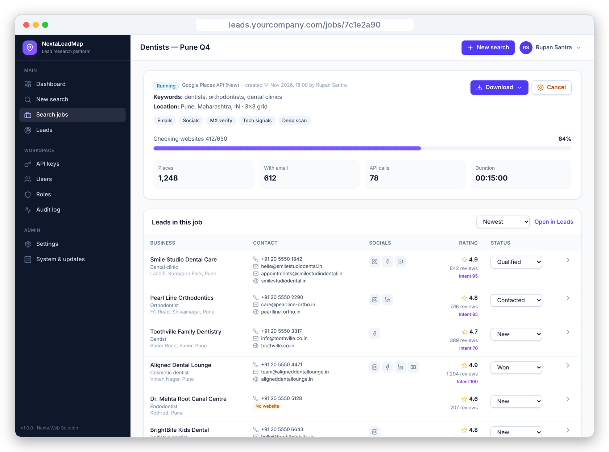</p>

### 3 · Work your leads
Every lead across every search in one place. Filter by email, phone, website, rating, reviews or intent score;
move leads through your pipeline; export CSV or JSON.

<p align="center">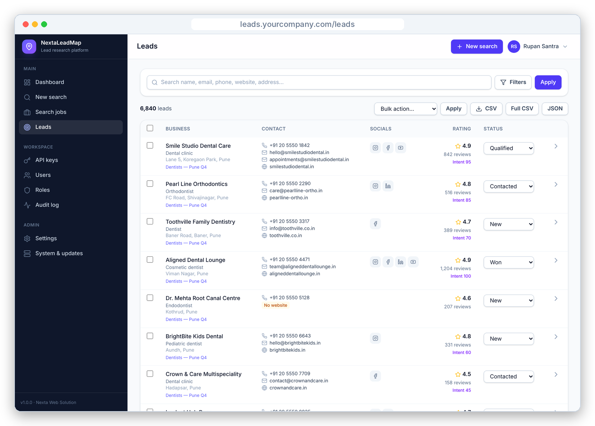</p>

<details>
<summary><b>More screens</b> — dashboard, lead detail, settings, system</summary>
<br>

**Dashboard** — totals, 30-day trend, top categories and pipeline at a glance.
<p align="center">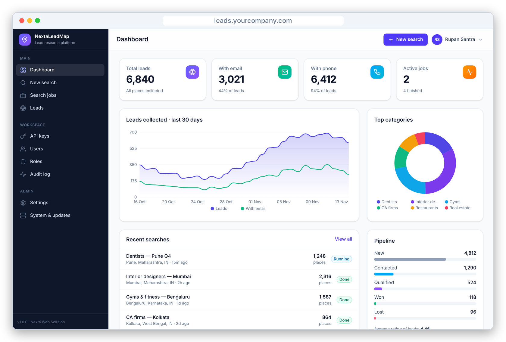</p>

**Lead detail** — everything about one business, its marketing stack and your notes.
<p align="center">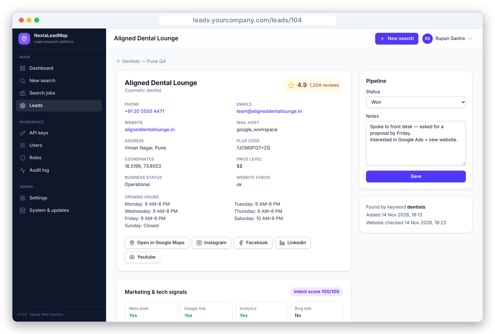</p>

**Search history**
<p align="center">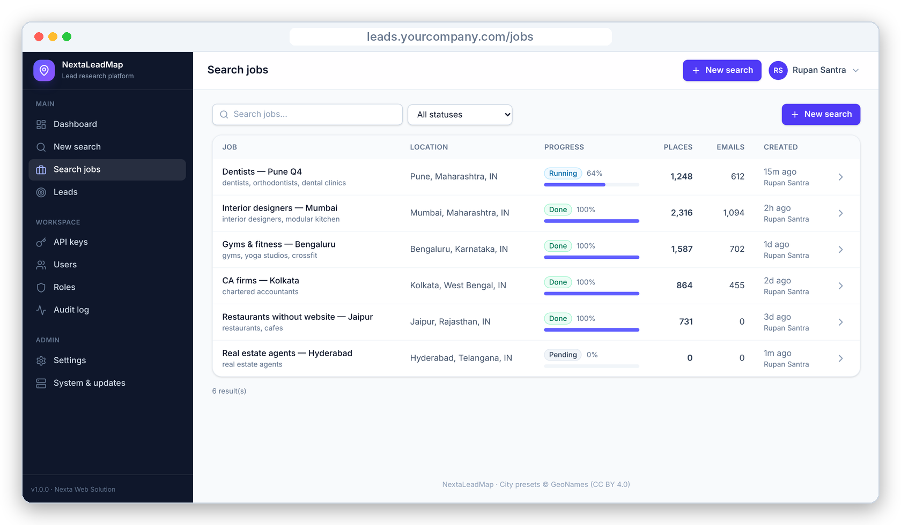</p>

**Provider keys** — stored encrypted, never shown again, with a one-click connection test.
<p align="center">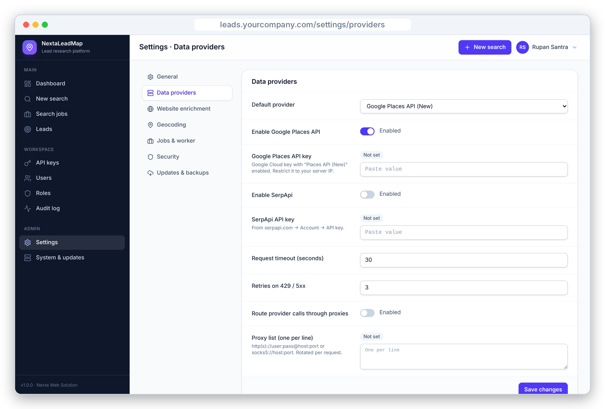</p>

**System** — live security checklist, worker status, backups and signed updates.
<p align="center">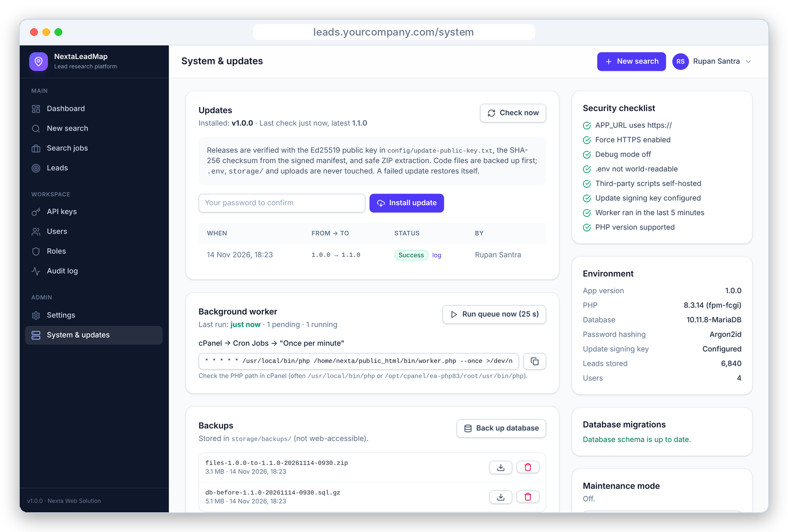</p>
</details>

### 📱 Works on your phone
Every screen is built mobile-first: check a job from the field, call or email a lead with one tap.

<p align="center">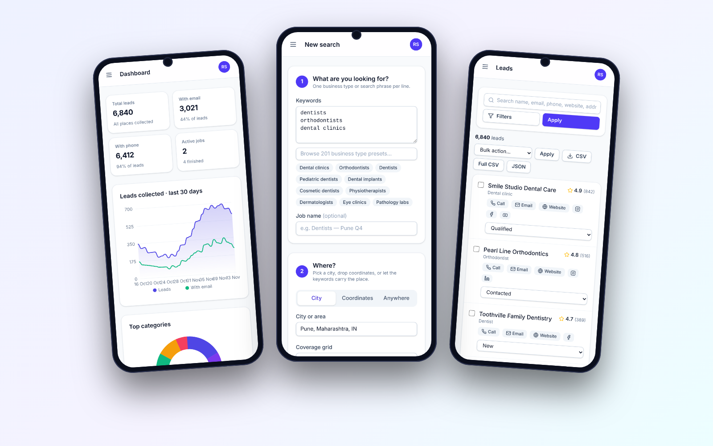</p>

---

## ✨ What you get

| | |
|---|---|
| 🔎 **Search** | Many keywords per job · city autocomplete (168k GeoNames cities), coordinates or "use my location" · 1–120 results per search · language & country |
| 🗺️ **Coverage** | **N×N grid** over the city · **deep scan** splits any tile that hits the provider cap into 4 smaller tiles (2 levels) · duplicates removed |
| 📧 **Emails** | Homepage **and** contact/about pages · up to 3 per business, own domain first · junk, no-reply, abuse and platform addresses dropped |
| ✅ **Email checks** | MX lookup labels each domain `google_workspace`, `microsoft_365` or `other`, and drops dead domains |
| 🔗 **Social profiles** | Instagram, Facebook, LinkedIn, TikTok, YouTube, X — real profiles, not share buttons |
| 🎯 **Intent score** | Detects Meta pixel, Google Ads tag, analytics, Bing Ads, LinkedIn Insight, TikTok pixel, CMS and mobile support, then scores 0–100 |
| 🧹 **Smart filters** | "Only businesses **without** a website" · skip places found in earlier jobs (weekly re-runs return only new leads) · "is this really their website?" check |
| 📊 **Lead CRM** | Pipeline status (new → contacted → qualified → won / lost) · notes · bulk actions · search across all jobs |
| 📤 **Exports** | Outreach CSV, full CSV (35+ columns), JSON — Excel-safe (formula-injection guard) |
| 👥 **Team** | Users, roles and an editable permission matrix · each user sees only their own data unless allowed · audit log |
| 🔌 **REST API** | Scoped API keys with expiry, per-key rate limits — plug into n8n, Zapier, Make or your CRM |
| ⚙️ **Operations** | Web installer · cron or daemon worker with automatic resume · DB backups · **signed one-click updates** with rollback · maintenance mode |

### Sample output

`dentists-pune-q4-7c1e2a90-leads.csv` — sample rows:

| title | phone | emails | website | category | rating | reviews | instagram | intent_score |
|---|---|---|---|---|---|---|---|---|
| Aligned Dental Lounge | +91 20 5550 4471 | team@aligneddentallounge.in | aligneddentallounge.in | Cosmetic dentist | 4.9 | 1,204 | instagram.com/aligneddental | 100 |
| Smile Studio Dental Care | +91 20 5550 1842 | hello@smilestudiodental.in | smilestudiodental.in | Dental clinic | 4.9 | 842 | instagram.com/smilestudiodental | 95 |
| Dr. Mehta Root Canal Centre | +91 20 5550 5128 | | | Endodontist | 4.6 | 207 | | |

---

## 🧭 How it works

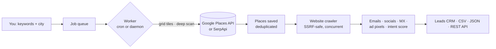

Place data comes from **licensed providers** — the official **Google Places API (New)** (up to 60 results per
search) or **SerpApi's Google Maps engine** (up to 120). You add their keys in the admin panel; they are encrypted at rest.
Everything after that — crawling, extraction, scoring, CRM — runs on your own server.

---

## 🚀 Install in 10 minutes (cPanel)

**You need:** PHP 8.3 or 8.4 · MySQL 8+ or MariaDB 10.6+ · extensions `pdo_mysql curl mbstring openssl sodium zip zlib` (`intl` recommended).

1. **Create a database** — cPanel → *MySQL® Databases*: new database + user, *ALL PRIVILEGES*.
2. **Pick PHP 8.3** — cPanel → *MultiPHP Manager* / *Select PHP Version*, enable the extensions above.
3. **Upload** the release ZIP to `public_html` (or a sub-domain folder) and *Extract*. Best: point a sub-domain's document root at `public/`.
4. **Open your domain** — the installer checks the server, tests the database, writes `.env` with a random encryption key, creates tables and your admin account.
5. **Add the worker cron** (*Cron Jobs → Once per minute*). The exact command is on the **System** page:
   ```
   /usr/local/bin/php /home/USER/public_html/bin/worker.php --once >/dev/null 2>&1
   ```
6. **Add a provider key** — *Settings → Data providers* → paste a Google Places or SerpApi key → **Test**.
7. **Self-host the UI scripts** (removes the CDN from the security policy): `php bin/console.php assets:vendor`

That's it — click **New search**. VPS (Nginx + systemd worker) instructions are just below.

<details>
<summary><b>VPS (Nginx + PHP-FPM)</b></summary>

```nginx
server {
    server_name leads.example.com;
    root /var/www/nextaleadmap/public;
    index index.php;
    location / { try_files $uri /index.php?$query_string; }
    location ~ ^/index\.php$ { include fastcgi_params; fastcgi_pass unix:/run/php/php8.3-fpm.sock;
        fastcgi_param SCRIPT_FILENAME $document_root/index.php; fastcgi_param HTTP_AUTHORIZATION $http_authorization; }
    location ~ \.php$ { return 404; }
    location ~ /\. { deny all; }
}
```

```ini
# /etc/systemd/system/nextaleadmap-worker.service
[Service]
User=www-data
ExecStart=/usr/bin/php /var/www/nextaleadmap/bin/worker.php --daemon
Restart=always
[Install]
WantedBy=multi-user.target
```
</details>

---

## 🔌 REST API

Create a key under **API keys** (pick scopes and an expiry) and send it as `Authorization: Bearer nlm_…`.

```bash
# start a search
curl -X POST https://leads.example.com/api/v1/jobs \
  -H "Authorization: Bearer $KEY" -H "Content-Type: application/json" \
  -d '{"keywords":["dentists"],"location_mode":"city","city":"Pune, Maharashtra","grid":3,"emails":true,"tech":true}'

# poll progress, then download
curl -H "Authorization: Bearer $KEY" https://leads.example.com/api/v1/jobs/JOB_ID
curl -H "Authorization: Bearer $KEY" -o leads.csv "https://leads.example.com/api/v1/jobs/JOB_ID/download?format=leads"

# search leads and update the pipeline
curl -H "Authorization: Bearer $KEY" "https://leads.example.com/api/v1/leads?has_email=yes&min_rating=4&sort=score"
curl -X PATCH -H "Authorization: Bearer $KEY" -H "Content-Type: application/json" \
  -d '{"lead_status":"contacted"}' https://leads.example.com/api/v1/leads/123
```

`GET /api/v1` lists every endpoint. Responses include `X-RateLimit-Limit` / `X-RateLimit-Remaining`.

---

## ⚖️ How it compares

| | **NextaLeadMap** | Manual research | Pay-per-result scraping services | Desktop scraper scripts |
|---|---|---|---|---|
| Time for 1,000 leads | ✅ Minutes, in the background | ❌ Days | ✅ Minutes | 🟡 Minutes, on your laptop |
| Emails + social profiles | ✅ Built in | 🟡 By hand | 🟡 Usually a paid add-on | 🟡 Varies |
| Ad-pixel intent score | ✅ Built in | ❌ | ❌ Rarely | 🟡 Some |
| Whole-city coverage | ✅ Grid + deep scan | ❌ | ✅ | 🟡 Varies |
| Team, roles, CRM pipeline | ✅ | ❌ | ❌ | ❌ |
| Data stays on your server | ✅ | ✅ | ❌ | ✅ |
| Runs on shared hosting | ✅ cPanel | ➖ | ➖ | ❌ Needs Python/Chrome |
| Cost per lead | ✅ Provider API cost only | ❌ Staff time | ❌ Per result | ✅ Free, against Google's ToS |

---

## 🛡️ Security

Audited before release — **[read the full report](SECURITY-AUDIT.md)**. Highlights:

- Prepared statements everywhere · CSRF on every change · strict Content-Security-Policy with nonces
- Argon2id passwords · login lockout · session hardening · anti-privilege-escalation rules
- Provider keys encrypted (libsodium) · API keys stored only as hashes
- SSRF-safe crawler (public IPs only, DNS pinning, size and time caps)
- **Ed25519-signed updates** with checksum, safe extraction, backups and automatic rollback
- Live security checklist on the System page · 117 automated tests

---

## 📏 Honest limits

- **Data comes through provider APIs**, so each search costs provider credits (Google Places or SerpApi pricing applies). The summary on the New search screen shows the maximum API calls before you start.
- **Per-search caps:** 60 results with Google Places, 120 with SerpApi. Use the grid and deep scan for whole cities.
- **Emails only when a business publishes one** on its website. Expect emails on part of the list, not all of it.
- **JavaScript-only websites** may hide emails from the crawler.
- **Phones and emails are personal data.** Follow India's DPDP Act, GDPR, CAN-SPAM and your provider's terms before outreach.

---

## ❓ FAQ

<details><summary><b>Do I need a Google Maps API key?</b></summary>
You need one data provider key: a Google Cloud key with <i>Places API (New)</i> enabled, or a SerpApi key. Paste it in Settings → Data providers.</details>

<details><summary><b>Will it run on my shared hosting?</b></summary>
Yes, if the host offers PHP 8.3+, MySQL/MariaDB and cron — which most cPanel hosts do. No SSH, Node.js or Docker needed.</details>

<details><summary><b>How many leads can I get?</b></summary>
Up to 60 (Google) or 120 (SerpApi) per search. A 3×3 grid runs 9 searches per keyword, and deep scan adds more where a tile is dense — thousands of places per city.</details>

<details><summary><b>Can my team use it?</b></summary>
Yes. Add users, give them roles (Administrator, Manager, Analyst, Viewer or your own), and each person works their own leads unless you let them see everyone's.</details>

<details><summary><b>How do updates work?</b></summary>
System → Install update. Releases are signed with your Ed25519 key, checksummed, backed up and rolled back automatically if anything fails. See <a href="UPDATES.md">UPDATES.md</a>.</details>

<details><summary><b>Can I connect it to n8n, Zapier or my CRM?</b></summary>
Yes, through the REST API with scoped keys — start jobs, poll progress, download results and update lead status.</details>

<details><summary><b>Console commands</b></summary>

```
php bin/console.php migrate | migrate:status | migrate:rollback
php bin/console.php user:create --email=a@b.com --name="Admin" --role=admin
php bin/console.php user:password --email=a@b.com        # reset + unlock
php bin/console.php worker:run --seconds=55
php bin/console.php update:check | update:apply | update:recover
php bin/console.php backup:db | db:restore storage/backups/db-….sql.gz --force
php bin/console.php assets:vendor                         # self-host Alpine.js + Chart.js
php bin/console.php maintenance:on | maintenance:off
php tests/run.php                                          # self-test
```
</details>

---

## 🤝 Built by Nexta Web Solution

<p>
  
</p>

Want it installed, branded for your agency, or customised for your workflow?
Book a free demo: 🌐 [nextawebsolution.com](https://nextawebsolution.com) · 📞 +91 22 6998 9200

